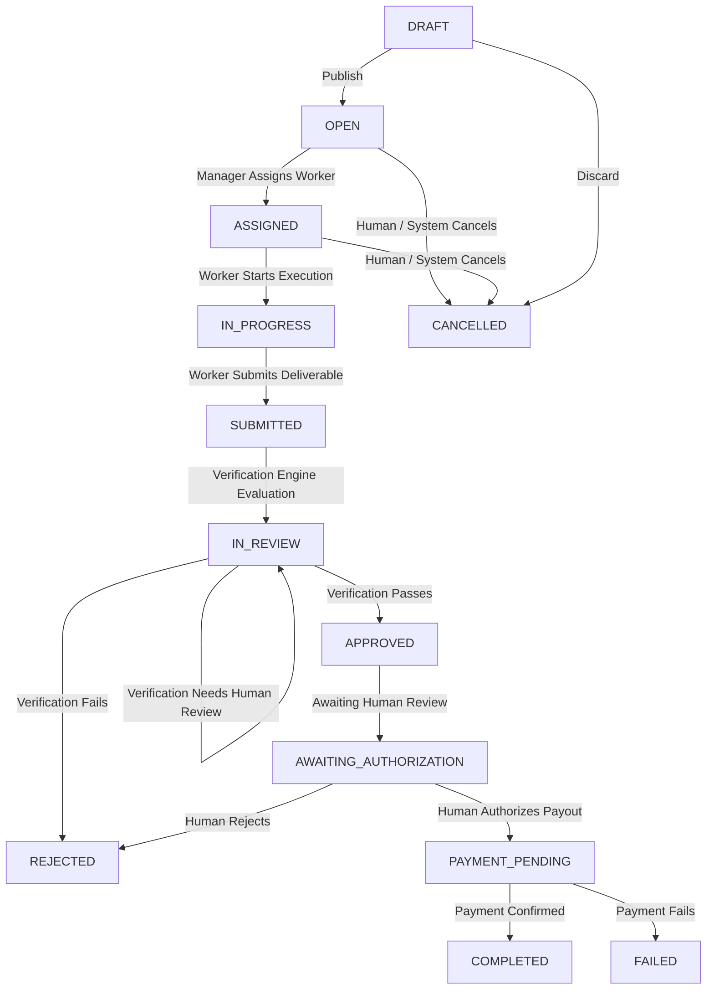
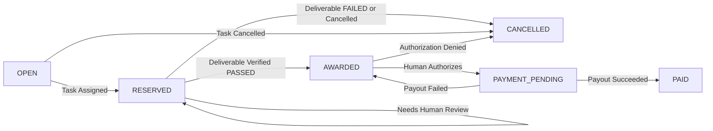
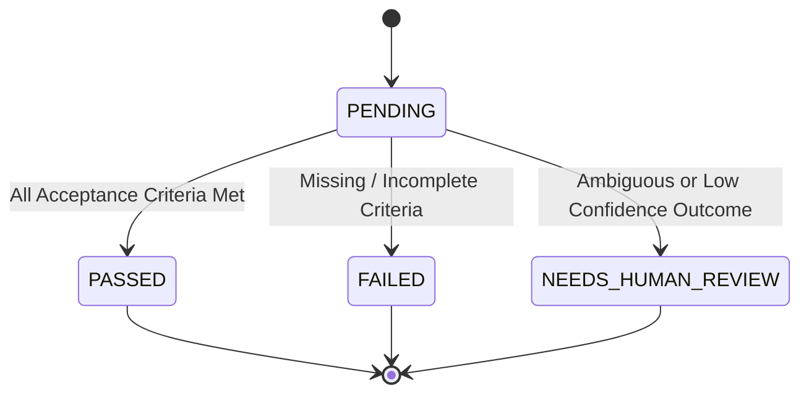
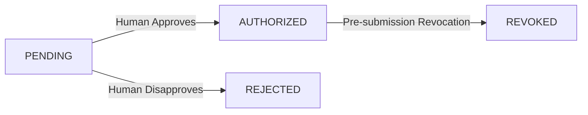
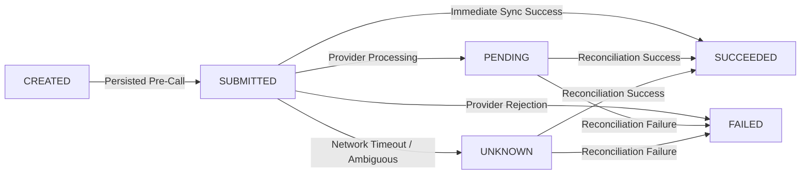

# AgentBounty — Lifecycle & State Machines

## 1. Task Lifecycle State Machine

The `Task` entity coordinates the progression from initial human prompt to completion or failure.

### Transition Gates & Authorities:
| Initial State | Target State | Triggering Event | Gate / Authority |
|---|---|---|---|
| `DRAFT` | `OPEN` | Task published to marketplace | Human Creator |
| `OPEN` | `ASSIGNED` | Worker selected & bounty reserved | Manager Agent |
| `ASSIGNED` | `IN_PROGRESS` | Execution begins | Worker Agent |
| `IN_PROGRESS` | `SUBMITTED` | Deliverable uploaded | Worker Agent |
| `SUBMITTED` | `IN_REVIEW` | Verification begins | Verification Engine |
| `IN_REVIEW` | `REJECTED` | Verification criteria failed | Independent Verification Engine |
| `IN_REVIEW` | `IN_REVIEW` | Verification requires human review | Independent Verification Engine (Ambiguous/Subjective Criteria) |
| `IN_REVIEW` | `APPROVED` | All criteria satisfied (100% / passed) | Independent Verification Engine |
| `APPROVED` | `AWAITING_AUTHORIZATION` | Enters financial review queue | Automated Pipeline Gate |
| `AWAITING_AUTHORIZATION`| `PAYMENT_PENDING` | Payment authorization granted | **Explicit Human Authorization** (Mandatory) |
| `AWAITING_AUTHORIZATION`| `REJECTED` | Authorization rejected by human | **Human Operator Decision** |
| `PAYMENT_PENDING` | `COMPLETED` | Payout confirmed by provider | Payment Provider Callback / Result |
| `PAYMENT_PENDING` | `FAILED` | Provider payout failure | Payment Provider Callback / Result |
| `*` | `CANCELLED` | Explicit cancellation | Human Creator or System Admin |

---

## 2. Bounty Lifecycle State Machine

A task possesses at most one bounty. The bounty coordinates monetary liability.

### States:
- `OPEN`: Bounty allocated but not yet reserved by a worker.
- `RESERVED`: Manager agent has assigned the task to a worker; funds are set aside.
- `AWARDED`: Independent verification confirmed deliverables met criteria; awaiting financial payout authorization.
- `PAYMENT_PENDING`: Human approved payout; payment provider processing disbursement.
- `PAID`: Funds successfully disbursed to recipient.
- `CANCELLED`: Bounty deallocated due to task rejection or cancellation.

---

## 3. Independent Verification State Machine

Evaluates deliverables submitted by Worker Agents against predefined acceptance criteria.

### Key Verification Rule:
The Worker Agent **never** verifies its own work. The Verification Engine runs in a separate process or isolated context to ensure objective evaluation.

---

## 4. Payment Authorization State Machine

The `PaymentAuthorization` entity preserves an immutable record of financial authorization decisions.

### Rules:
- An authorization record must specify the exact amount in minor units and currency.
- **Actor Role Invariant:** Authorization and revocation decisions require `ActorContext.actor_type == "HUMAN"`. This is an application-level role check, not independent identity authentication.
- Pre-submission revocation is allowed if no transaction has commenced submission (`SUBMITTED`). Once payment submission has started, revocation is prohibited (`InvalidStateTransitionError`).
- Once created, a `PaymentAuthorization` cannot be deleted or mutated.

---

## 5. Payment Transaction State Machine

Payment transactions track the payment execution lifecycle through the configured provider (`MockPaymentProvider` or `PayPalSandboxProvider`).

### Idempotency & Duplicate Handling:
- **Deterministic Key:** `idemp_{sha256(task_id:authorization_id)[:32]}` enforced via a database unique constraint.
- **Duplicate Execution Behavior:**
  - `SUCCEEDED`, `PENDING`, `SUBMITTED`, `UNKNOWN`, `CREATED`: Returns the authoritative existing transaction (`is_duplicate=True`) without calling the provider.
  - `FAILED`: Raises `DuplicatePaymentError`. Automatic silent retries are strictly forbidden. Resolution requires human intervention.
- **State Changes by Outcome:**
  - `SUCCEEDED`: Transaction `SUCCEEDED`, Task `COMPLETED`, Bounty `PAID`.
  - `PENDING`: Transaction `PENDING`, Task `PAYMENT_PENDING`, Bounty `PAYMENT_PENDING`.
  - `UNKNOWN`: Transaction `UNKNOWN`, Task `PAYMENT_PENDING`, Bounty `PAYMENT_PENDING`.
  - `FAILED`: Transaction `FAILED`, Task `FAILED`, Bounty reverts to `AWARDED`.
